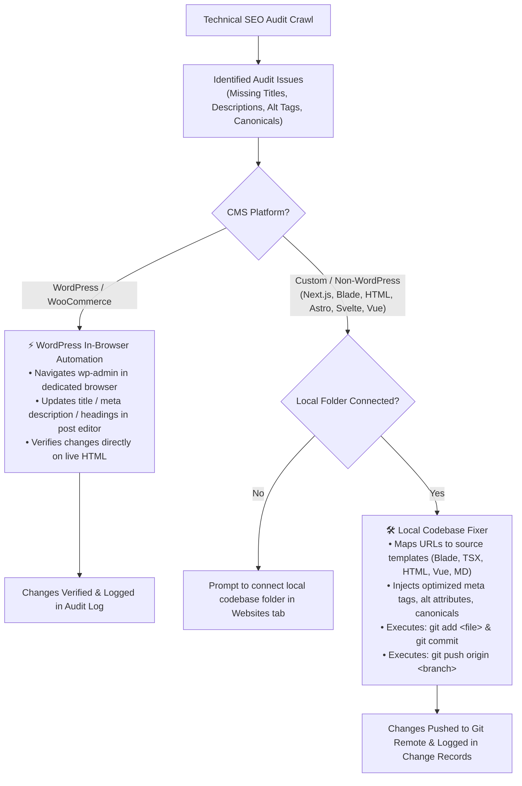

# 🤖 Autonomous AI SEO Specialist Agent & Chrome Extension

> An autonomous, browser-controlled AI SEO specialist and Manifest V3 Chrome Extension that automates the entire search ranking lifecycle—from domain onboarding and Google Search Console management to technical audits, automated WordPress CMS fixes, and direct code template modifications with automated Git pushes.

[](https://www.python.org/)
[](https://fastapi.tiangolo.com/)
[](https://react.dev/)
[](https://www.typescriptlang.org/)
[](https://developer.chrome.com/docs/extensions/mv3/)
[](https://playwright.dev/)
[]()

---

## 📌 Operating Principle: Browser UI First (Zero API Dependency)

Traditional SEO tools depend on restrictive, expensive third-party APIs or OAuth quotas. **This agent operates like an expert human SEO specialist sitting at a browser:**
- Operates Google Search Console directly via its modern Web UI using Playwright.
- Never gets blocked by API scope restrictions or quota limits.
- Persists user sessions inside an isolated, dedicated Chrome profile (`%LOCALAPPDATA%\AI_SEO_Agent\ChromeProfile`).
- Safely pauses and prompts for **Human Takeover** if CAPTCHAs, MFA/2FA, or login challenges arise.

---

## 🌟 Key Features

### 1. 🔄 Complete 10-Stage Autonomous SEO Ranking Pipeline
Execute end-to-end ranking operations for any domain from scratch:
1. **Understand Business & Audience:** Analyzes website offerings, target customers, service locations, and SEO goals.
2. **Keyword Research & Intent Clustering:** Discovers queries, clusters by commercial/informational intent, and computes Opportunity Scores (0–100).
3. **Comprehensive Site Audit:** Polite async crawler audits title tags, meta descriptions, headings, canonicals, alt tags, and JSON-LD schemas.
4. **Fix Technical SEO:** Resolves robots.txt barriers, canonical conflicts, HTTP status issues, and sitemap errors.
5. **Optimize Every Important Page:** Generates high-CTR meta titles, descriptions, and headings with character-count validation.
6. **Content Gap Identification:** Discovers underserved search intents and drafts actionable content briefs.
7. **Internal Linking & Authority Roadmap:** Mapped contextual anchor links and backlink acquisition hooks.
8. **GSC Property Setup & Indexing Submission:** Registers properties in Google Search Console, submits sitemaps, and requests live URL indexing.
9. **Measure Organic Performance:** Extracts clicks, impressions, CTR, and SERP positions directly from Search Console tables.
10. **Continuous Autonomous Cycle:** Schedules recurring background audits and proactive ranking improvements.

---

### 2. ⚡ Dual-Pathway Automated Fixing Engine

When technical or on-page audit issues are identified, the agent automatically executes the appropriate fix:



- **WordPress / WooCommerce:** Updates meta tags, post slugs, titles, and descriptions directly inside `wp-admin` via browser automation and verifies the rendered HTML.
- **Custom Codebases (Next.js, React, Laravel Blade, HTML, Astro, Svelte, Vue, Markdown):**
  - Directly maps URLs to project source files (`app/page.tsx`, `resources/views/welcome.blade.php`, `index.html`, etc.).
  - Safely modifies code templates with regex injectors for `<title>`, `<meta name="description">`, `<h1>`, ` alt`, `<link rel="canonical">`, and JSON-LD structured data.
  - Automatically runs `git add`, generates structured commit messages, and pushes to your configured Git remote (`origin`) and branch (`main`).
  - Records full before/after diffs in SQLite with **1-Click Rollback** capability.

---

### 3. 🖥️ Manifest V3 Chrome Extension (Side Panel)
- Modern UI built with **React 19**, **TypeScript**, **Vite**, and **Tailwind CSS**.
- **14 Dedicated Views:**
  - **Dashboard:** SEO health score, active engine status, quick crawlers, and performance summary.
  - **Connected Websites:** Manage connected domains, configure CMS types, and edit settings inline.
  - **Full Domain Setup:** 1-click domain onboarding from scratch.
  - **Search Console:** Google Search Console UI automation with live browser screenshots.
  - **Site Audit:** Multi-page technical SEO inspection and issue inspector.
  - **Keyword Research:** Intent clustering, GSC search query analysis, and opportunity scoring.
  - **SEO Opportunities:** Side-by-side proposed optimizations with 1-click approval and execution.
  - **Content Optimizer:** Gemini-assisted meta title and description generator.
  - **URL Indexing:** Live inspection and instant Google indexing queue.
  - **Task Queue & Automation Rules:** Human-in-the-loop approval workflow and rate limits.
  - **Activity & Audit Logs:** Complete chronological history of all automated actions.
  - **Executive Reports:** Instant Markdown and PDF-ready SEO reports.
  - **Settings:** Security token pairing, profile paths, and engine controls.

---

### 4. 🛡️ Enterprise Security & Safety Guardrails
- **SSRF Defense:** Prevents crawling private, loopback, link-local, or cloud metadata IP ranges (`127.0.0.1`, `169.254.169.254`, `10.0.0.0/8`, etc.).
- **Untrusted Content Sanitization:** Cleans web crawl text to block indirect prompt injection attacks.
- **Pairing Token Authentication:** Local API endpoints require `X-Agent-Token` generated uniquely per environment.
- **Human Takeover Mechanism:** Automatically detects CAPTCHAs, two-factor authentication, or expired sessions and pauses execution until resolved by the human operator.
- **Zero Mock / Dummy Data Pollution:** Strictly isolates testing from production databases.

---

## 📁 Repository Structure

```
ai_seo/
├── agent/                       # Python Local Windows Automation Agent
│   ├── api/                     # FastAPI REST API & WebSocket server
│   │   ├── routes/              # websites, codebase, gsc, crawler, keywords, cms, onboarding, pipeline
│   │   └── main.py              # FastAPI application & lifespan events
│   ├── automation/              # Scheduling & continuous SEO loop
│   │   ├── queue.py             # Human-in-the-loop task queue
│   │   └── scheduler.py         # Autonomous 12-step cycle
│   ├── browser/                 # Playwright Browser Engine
│   │   ├── controller.py        # Isolated persistent Chrome session manager
│   │   ├── actions.py           # Human-like interaction (mouse, keystrokes, scroll)
│   │   └── recovery.py          # CAPTCHA, MFA, and session expiry detection
│   ├── crawler/                 # Multi-factor SEO spider & defect analyzer
│   ├── intelligence/            # Gemini AI analysis & keyword clustering
│   ├── models/                  # SQLAlchemy SQLite database models
│   ├── workflows/               # Specialized automation routines
│   │   ├── gsc/                 # Search Console browser workflows
│   │   ├── cms/                 # WordPress, WooCommerce, Laravel automation
│   │   ├── codebase/            # LocalCodebaseGitFixer (regex injectors & git push)
│   │   ├── onboarding.py        # Full domain onboarding coordinator
│   │   └── ranking_pipeline.py  # 10-stage autonomous ranking pipeline
│   ├── core/                    # Security, SSRF filters, database, config
│   └── run_agent.py             # Agent launcher
├── extension/                   # Chrome Extension (Manifest V3)
│   ├── src/
│   │   ├── components/          # 14 React view components
│   │   ├── services/api.ts      # Type-safe API client
│   │   └── types/index.ts       # TypeScript interfaces
│   ├── manifest.json            # Extension manifest
│   └── dist/                    # Compiled production build
├── scripts/                     # Windows automation helper scripts
│   ├── install.bat              # Setup Python environment & build extension
│   ├── start_agent.bat          # Launch the background Python agent
│   ├── launch_dedicated_chrome.bat # Open isolated Chrome profile
│   └── test_suite.bat           # Run complete pytest suite
├── tests/                       # Automated test suite (25 test cases)
└── docs/                        # Architectural & user guides
```

---

## 🚀 Quick Start Guide

### Prerequisites
- **OS:** Windows 10/11
- **Python:** 3.11+
- **Node.js:** 18+ & npm
- **Google Chrome** installed
- **Git** installed and available in PATH

---

### Step 1: Install Dependencies & Build
Run the automated Windows installation script:
```cmd
scripts\install.bat
```
*Or install manually:*
```bash
# Python Agent
python -m venv venv
.\venv\Scripts\pip install -r agent\requirements.txt
.\venv\Scripts\playwright install chromium

# Chrome Extension
npm --prefix extension install
npm --prefix extension run build
```

---

### Step 2: Set Up Dedicated Chrome Profile
Open the isolated automation Chrome profile:
```cmd
scripts\launch_dedicated_chrome.bat
```
1. Log into your Google account (for Google Search Console: `https://search.google.com/search-console`).
2. Log into your CMS admin panel (if managing WordPress / WooCommerce sites).
3. Close the browser. **Your session cookies are saved permanently in the dedicated profile** (`%LOCALAPPDATA%\AI_SEO_Agent\ChromeProfile`) and will be used by Playwright.

---

### Step 3: Configure Environment Variables
Copy `.env.example` to `.env` in the root directory:
```ini
AGENT_HOST=127.0.0.1
AGENT_PORT=8765
GEMINI_API_KEY=your_gemini_api_key_here
MAX_DAILY_ACTIONS=50
CHROME_PROFILE_DIR=%LOCALAPPDATA%\AI_SEO_Agent\ChromeProfile
```

---

### Step 4: Start the Agent Server
```cmd
scripts\start_agent.bat
```
The agent starts at `http://127.0.0.1:8765`. Your unique pairing token is saved in `agent/data/.agent_token` and displayed in the terminal.

---

### Step 5: Load the Chrome Extension
1. Open Google Chrome and navigate to `chrome://extensions`.
2. Enable **Developer mode** (top-right toggle).
3. Click **Load unpacked** and select the `extension/dist` folder in this repository.
4. Click the Extension icon in your Chrome toolbar or open the **Side Panel**.
5. Go to **Settings** in the extension and paste your pairing token.

---

## 🛠️ Usage Workflows

### 1. Connecting & Editing Websites
- Click **+ Add Website** in the **Connected Websites** view.
- **For WordPress:** Enter domain and admin URL (e.g., `https://example.com/wp-admin`).
- **For Custom Sites (Next.js, Laravel, HTML):** Enter domain and your local project path (e.g., `C:\Projects\my-site`), branch (`main`), and remote (`origin`).
- **Editing Existing Sites:** Click the **✏️ Edit** button on any website card to update the domain, CMS platform, automation mode, local codebase path, or Git settings.

### 2. Running the 10-Stage Ranking Workflow
- Click **10-Stage Ranking Workflow** on any website card.
- The agent crawls the site, clusters keywords, analyzes the business, detects content gaps, generates meta tag fixes, submits sitemaps, inspects URLs in Search Console, and establishes ranking baselines automatically.

### 3. 1-Click Auto-Fixing
- Navigate to **SEO Opportunities** or **Site Audit**.
- Click **⚡ Auto-Fix All**:
  - **WordPress:** The agent opens `wp-admin`, applies meta descriptions/titles/headings, and verifies live HTML.
  - **Custom Codebases:** The agent maps URLs to template files, injects optimized tags, creates a Git commit, and executes `git push`.

---

## 🧪 Testing

Run the automated test suite covering all security filters, database operations, intelligence modules, and the codebase Git fixer:
```bash
.\venv\Scripts\pytest -v tests/
```
```
======================= 25 passed, 5 warnings in 54.04s =======================
```

---

## 🔒 Security & Safety Guidelines

- **Zero Direct Exposure:** The Python agent binds strictly to `127.0.0.1` by default and requires an `X-Agent-Token` header for all requests.
- **Protected Actions:** Destructive operations (page deletion, robots.txt disallow rules, domain property removal) require manual approval through the Task Queue.
- **Isolated Browsing:** Your personal Chrome history, passwords, and extensions are never touched; the agent strictly operates inside its dedicated isolated profile directory.

---

## 📄 License

This project is licensed under the [MIT License](LICENSE).
